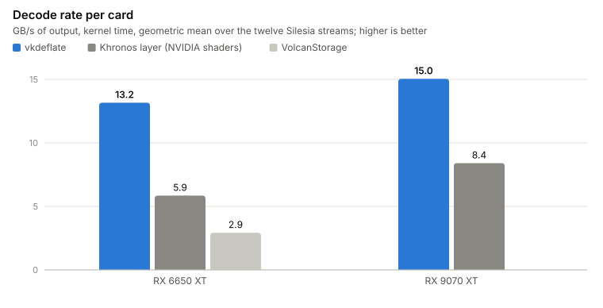

<h1 align="center">vkdeflate</h1>

<p align="center">
  
  
  
  
  <br>
  <a href="single_include/vkdeflate.h"></a>
  <a href="https://github.com/krisoft20/vkdeflate/releases/latest"></a>
  <a href="LICENSE"></a>
  <a href="docs/blog.md"></a>
</p>

GPU decompression of GDeflate for Vulkan on any vendor's card, in one MIT header. No driver extension needed.
An encoder, a file loader and a Vulkan layer are included.

| **[Blog](docs/blog.md)** | **[Format](docs/FORMAT.md)** | **[Kernel](docs/DESIGN.md)** |
|:---:|:---:|:---:|
| how it was built and measured, with charts | GDeflate 1.0 on two pages | how the shader decodes a tile, and its knobs |

GDeflate is the format behind DirectStorage and RTX IO. Vulkan has an extension for it,
`VK_EXT_memory_decompression`, but so far only NVIDIA's driver is known to implement it. vkdeflate is a compute shader and a small
host library that decode the same streams on AMD, Intel and anything else with Vulkan 1.2.

<picture>
  <source media="(prefers-color-scheme: dark)" srcset="docs/img/rates-dark.svg">
  
</picture>

On each card every decoder got the same compressed data. The Khronos layer is Khronos's open
implementation, with NVIDIA's shaders. On all 46 test streams vkdeflate is 1.66x to 4.8x faster on the RX 6650 XT.
On the RX 9070 XT, measured on the twelve Silesia streams, it is 1.47x to 2.9x faster.
VolcanStorage is a GLSL port of Microsoft's reference shader. As shipped it does not finish on the
RX 6650 XT, so it was measured after four fixes ([notebook](docs/notebook.md#volcanstorage)).
How this was measured, and where it does not hold: [the write-up](docs/blog.md).

**For you if**

- your Vulkan engine ships GDeflate assets and you want them decoded on AMD and Intel GPUs too;
- you are porting a DirectStorage title natively to Linux or the Steam Deck and want to keep its packs;
- you want to understand the format: [`docs/FORMAT.md`](docs/FORMAT.md) and a readable CPU decoder come with it.

**Not for you if**

- you are on Direct3D 12 on Windows: DirectStorage already does this;
- your loading time is not spent in decompression, which is most games. GPU decompression only takes that one
  cost off the CPU.

## Use it

Copy [`single_include/vkdeflate.h`](single_include/vkdeflate.h) into your project, or take the CMake target
`vkdeflate::vkdeflate` with `FetchContent`. It needs C++17 and the Vulkan headers; the shader is inside.
With vcpkg: `vcpkg install vkdeflate --overlay-ports=<repo>/ports`.

| you want | use |
|---|---|
| a file on disk in a buffer or an image | `vkdeflate::load()` |
| a dispatch in your own command buffer | `vkdeflate::record()` |
| to keep code written for `VK_EXT_memory_decompression` | `vkdeflate::cmd_decompress_memory()` |
| no code change | the layer |
| to make `.gdz` streams | `gdz -c`, or `gdeflate::compress()` |
| C, or bindings for another language | [`vkdeflate_c.h`](single_include/vkdeflate_c.h) |

A `.gdz` file is a bare GDeflate stream, the bytes `gdeflate::compress()` returns. There is no container.

**1. Create your device with the features the kernel needs.** Vulkan has no query for the features a device was
created with, so pass the `VkDeviceCreateInfo` to `attach()`: a missing feature then fails the call with its name
in `err`, not later inside the driver.

```cpp
#define VKDEFLATE_IMPLEMENTATION          // in one .cpp
#include "vkdeflate.h"

std::string err;
vkdeflate::features_t need;               // returns false when the card lacks a feature
vkdeflate::device_features(instance, phys, vkGetInstanceProcAddr, need, err);
device_info.pNext = &need.base;           // or copy its bits into your own feature structs
// if need.extension is not null, add it to the device's extension list
vkCreateDevice(phys, &device_info, nullptr, &device);
```

**2. Attach once, then load.**

```cpp
vkdeflate::config_t cfg;
cfg.created_with = &device_info;          // optional: step 1 is checked at attach
cfg.pipeline_cache = cache;               // optional: the first attach compiles the shader, 1.5 s on an RX 6650 XT
vkdeflate::ctx_t* ctx = vkdeflate::attach(instance, phys, device, vkGetInstanceProcAddr, cfg, err);

vkdeflate::load_t item;
item.path = "rock_albedo.gdz";            // or item.data and item.size for bytes from your own archive
item.image = image;                       // or item.buffer
item.extent = {2048, 2048, 1};
vkdeflate::load(ctx, queue, queue_family, &item, 1, err);
```

`load()` decodes on the GPU, copies the result into your buffer or image, submits to the queue you pass and
returns when the GPU is done. Several items share one dispatch.

- An image gets one subresource by default and ends in `item.layout` (`SHADER_READ_ONLY_OPTIMAL` unless you set
  it); what was in it before is discarded. For a mip chain or array layers in one stream, set `item.regions` to
  your `VkBufferImageCopy` list, with offsets counted from the start of the decoded data.
- A context is for one thread at a time, and `load()` submits to the queue during the call. To stay inside your own frame, call
  `record_load(ctx, cmd, ...)` in your command buffer and `load_result(ctx, err)` after it has run; one load in
  flight per context.
- The staging buffers stay allocated for the next call. `trim(ctx)` frees them.
- `load()` reads files with `config_t::read_threads` threads (4) and cuts the work into chunks of
  `load_chunk_tiles` tiles (512): the next chunk is read while the GPU decodes the last one. The twelve Silesia
  streams in one call, 212 MB, RX 6650 XT, NVMe drive: 20 ms from cached files, 60 ms from files not in the OS
  cache. `record_load()` reads on the calling thread, in one piece.
- `config_t::bounds_checks` is on by default. Off, the kernel is about 3 % faster, and a broken or hostile stream
  can write past its tile or never finish. Turn it off only for files you compressed yourself.
- Leave the other fields of `config_t` at their defaults; they are kernel tuning knobs for the benchmark.

<details>
<summary>In your own command buffer</summary>

```cpp
std::vector<vkdeflate::tile_desc_t> tiles;   // per stream, from its first 8 + 4 * tile_count bytes
size_t out_size;
vkdeflate::describe(stream, header_bytes, stream_size, tiles, out_size, err);

// the stream, the tile table, the output and one uint32_t of status per tile live in your buffers
vkdeflate::record(ctx, cmd, {src_addr, tiles_addr, dst_addr, status_addr, (uint32_t)tiles.size(),
                             vkdeflate::job_flags(tiles, out_size)});
```

`record()` is one dispatch. You add the barriers around it and check the status words (0 is good,
`vkdeflate::tile_error()` names the rest). `describe()` returns the tiles largest first, which shortens the
dispatch; `status[i]` belongs to `tiles[i]`. `job_flags()` picks the pipeline for streams that are mostly long runs.

</details>

<details>
<summary>Code written for VK_EXT_memory_decompression</summary>

```cpp
vkdeflate::cmd_decompress_memory(ctx, cmd, &info);   // the VkDecompressMemoryInfoEXT you would pass to the driver
vkdeflate::record_regions_indirect(ctx, cmd, regions_addr, count_addr, max_count, stride);
```

</details>

<details>
<summary>The layer: no code change</summary>

The build makes `build/layer/VkLayer_vkdeflate` and its manifest. With these two variables set, an application
gets `VK_EXT_memory_decompression` and `VK_NV_memory_decompression` on a driver that has neither:

    VK_LAYER_PATH=<repo>/build/layer
    VK_INSTANCE_LAYERS=VK_LAYER_vkdeflate_memory_decompression

</details>

<details>
<summary>Making streams</summary>

    build\gdz.exe -c rock_albedo.bc7 -o rock_albedo.gdz        level 6; -level 1..12

`gdz` is also in the benchmark package of every release, so packing needs no build.

Against the reference encoder at the same level, Silesia corpus, 12 threads, both run back to back into a
buffer allocated beforehand:

| level | size | packing speed |
|---|---|---|
| 1 to 4 | 0.1 to 0.6 % smaller | 11 to 18 % faster |
| 5 to 7 | 0.07 to 0.1 % smaller | 6 to 19 % faster |
| 8, 9 | 0.2 % smaller | 25 to 29 % faster |
| 10 to 12 | 0.01 to 0.2 % smaller | 9 to 12 % faster |

The output decodes with Microsoft's reference decoder.

</details>

<details>
<summary>What the device needs, by name</summary>

Vulkan 1.2 with `shaderInt64`, `shaderInt8`, `storageBuffer8BitAccess`, `bufferDeviceAddress` and
`vulkanMemoryModel`, and a subgroup of 32 lanes: native, or chosen through `subgroupSizeControl` and
`computeFullSubgroups` (core in 1.3, `VK_EXT_subgroup_size_control` before). `device_features()` sets exactly
these. With the layer they are enabled at device creation. `gdeflate::decompress()` in the same header is the CPU fallback.

</details>

[`examples/`](examples/README.md) has five short programs, one per way in. They include only `vkdeflate.h`, so
they compile against the single header as they are; [`common.h`](examples/common.h) shows a complete device setup.

## Benchmark it on your card

Without a compiler: download `vkdeflate-bench-<version>-windows.zip` or `-linux.tar.gz` from the
[latest release](https://github.com/krisoft20/vkdeflate/releases/latest), unpack it and run `bench.cmd` or
`./bench.sh` (Linux needs curl and unzip).

From the source: Windows with Visual Studio's C++ and CMake tools, and git; or Linux with CMake, a C++17 compiler,
git, curl and unzip. The Vulkan SDK is not needed: the compiled shader is in the repository and the build fetches
Khronos's Vulkan headers if it finds none.

    .\build.cmd           ./build.sh
    .\bench.cmd           ./bench.sh          the Silesia corpus on your GPU, written to results\<gpu>.csv and .txt
    .\bench.cmd -khr      ./bench.sh -khr     the same streams through the Khronos layer too (needs python)

`bench.cmd` downloads the corpus (66 MB), builds the reference encoder, compresses the twelve files and checks every
decoded byte against the CPU decoder. Results so far, geometric mean of the kernel rate over the twelve streams:

<!-- cards:begin -->
| GPU | driver | streams | vkdeflate, GB/s | Khronos layer, GB/s | vkdeflate / layer |
|---|---|---|---|---|---|
| AMD Radeon RX 6650 XT | AMD proprietary driver 26.10.1 (AMD proprietary shader compiler) | 12 | 14.7 | 5.9 | 2.5× |
| AMD Radeon RX 9070 XT | AMD proprietary driver 26.10.1 (LLPC) | 12 | 15.9 | 8.4 | 1.9× |
<!-- cards:end -->

Per stream on the RX 6650 XT:

<picture>
  <source media="(prefers-color-scheme: dark)" srcset="docs/img/khronos_AMD_Radeon_RX_6650_XT-dark.svg">
  
</picture>

A card that is not in this table is the most useful thing you can add: open a pull request with your
`results\*.csv`. RDNA 4 owners especially, see Limits.

## Limits

- The subgroup-size-32 path and the features above are checked at start-up, but nobody has run it on NVIDIA or
  Intel yet.
- The rates are kernel time on the GPU. Into host memory the PCIe copy caps a stream at 3-6 GB/s; into GPU memory
  only the compressed bytes cross the bus.
- A dispatch of fewer than about 100 tiles (6 MB) costs 0.5 to 1 ms whatever its size. Batch streams into one
  command buffer.
- On RDNA 4 the lead over the Khronos layer is smaller (1.9x on an RX 9070 XT, 2.5x on an RX 6650 XT). One tile
  is decoded by one wave, and a wave takes 23 to 30 % longer per tile on the RX 9070 XT. The card has room to
  spare, so a dispatch there takes as long as its slowest tile. Volunteers wanted:
  `bench.cmd -khr` and the CSV, see [`CONTRIBUTING.md`](CONTRIBUTING.md).
- Subgroups narrower than 32 lanes (Mali, PowerVR, software renderers such as llvmpipe) are not supported.
- On Linux the build and the CPU tests pass (gcc 13, Ubuntu 24.04 under WSL); no Linux GPU has run the kernel yet.
- The layer, `load()` and the encoder are new and have run on one card, an RX 6650 XT. `load()` blocks until the
  GPU is done and takes at most 4 GB per call.
- GDeflate compresses like zlib. zstd and Oodle pack tighter; the larger files are the price of a format a GPU can decode.

## More

- [`docs/notebook.md`](docs/notebook.md): what was tried and the numbers.
- [`CONTRIBUTING.md`](CONTRIBUTING.md): how to send a result from your card.
- `build\gdz.exe` packs, decodes, validates and fuzzes. `attach_test`, `layer_test` and `c_test` check the API,
  the layer and the C interface.

## Sources and licenses

No code was copied from any of these; the decoders and the encoder are written from `docs/FORMAT.md`.

| source | what for | license |
|---|---|---|
| Microsoft `DirectStorage` repository, `GDeflate/` (README, `TileStream.h`, `GDeflateCompress.cpp`, `GDeflateDecompress.cpp`, `shaders/GDeflate.hlsl`, `shaders/tilestream.hlsl`) | container layout, the public format prose, the reference GPU decoder | repository MIT (Microsoft); the GDeflate library and shaders carry Apache License 2.0 headers (NVIDIA 2020-2022, Microsoft) |
| NVIDIA `libdeflate` fork, commit 8ba9502 (`lib/gdeflate_*.c`, `lib/gdeflate_decompress_template.h`, `lib/deflate_compress.c`, `lib/deflate_decompress.c`, `lib/deflate_constants.h`) | what the reference encoder writes, DEFLATE64 tables, Huffman validity rules | MIT (Eric Biggers) with NVIDIA's changes under Apache License 2.0 |
| NVIDIA nvCOMP documentation, GDeflate page | the same format prose | copyright NVIDIA, no stated license |
| Khronos reference pages for `VK_EXT_memory_decompression` | what a decompression region is | Khronos, CC BY 4.0 |
| Khronos `Vulkan-ExtensionLayer`, `layers/decompression` (`decompression.cpp`, `TileDecoder.glsl`) | the layer's calling contract for `tools/bench.cpp` (one raw tile per region, the indirect path), nothing of its decoder | Apache-2.0 or MIT |
| Khronos `Vulkan-Headers`, tag v1.4.357 | fetched into `third_party_build` when the build finds no Vulkan headers; not part of this repository | Apache-2.0 or MIT |
| `ahmetenesay/VolcanStorage`, `shaders/GDeflate.comp` at 3d1df3e | measured in the benchmark after four fixes, nothing used | Apache-2.0 |
| RFC 1951 | DEFLATE | IETF |

## License

MIT, see `LICENSE`. Copyright (c) 2026 krisoft20.
