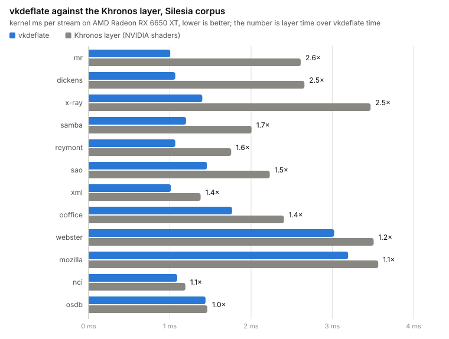

# vkdeflate

GPU decompression of GDeflate for Vulkan on any vendor's card: one header, MIT, no driver extension, no layer.

| **[Blog](docs/blog.md)** | **[Format](docs/FORMAT.md)** | **[Kernel](docs/DESIGN.md)** |
|:---:|:---:|:---:|
| how it was built and measured, with charts | GDeflate 1.0 on two pages | how the shader decodes a tile, and its knobs |

GDeflate is the format behind DirectStorage and RTX IO. Vulkan has an extension for it,
`VK_EXT_memory_decompression`, but so far only NVIDIA's driver is known to implement it. vkdeflate is a compute shader and a small
host library that decode the same streams on AMD, Intel and anything else with Vulkan 1.3.

<picture>
  <source media="(prefers-color-scheme: dark)" srcset="docs/img/khronos_AMD_Radeon_RX_6650_XT-dark.svg">
  
</picture>

Both decoders read the same buffers on the same card; the layer is Khronos's open implementation, with NVIDIA's
shaders. How this was measured, and where it does not hold: [the write-up](docs/blog.md).

**For you if**

- your Vulkan engine ships GDeflate assets and you want them decoded on AMD and Intel GPUs too;
- you are porting a DirectStorage title natively to Linux or the Steam Deck and want to keep its packs;
- you want to understand the format: [`docs/FORMAT.md`](docs/FORMAT.md) and a readable CPU decoder come with it.

**Not for you if**

- you are on Direct3D 12 on Windows: DirectStorage already does this;
- your loading time is not spent in decompression, which is most games. GPU decompression only takes that one
  cost off the CPU.

## Use it

Copy [`single_include/vkdeflate.h`](single_include/vkdeflate.h) into your project. It needs C++17 and the Vulkan
headers; the shader is inside as SPIR-V.

```cpp
#define VKDEFLATE_IMPLEMENTATION          // in one .cpp
#include "vkdeflate.h"

std::string err;
vkdeflate::ctx_t* ctx = vkdeflate::attach(instance, phys, device, vkGetInstanceProcAddr, {}, err);   // once

std::vector<vkdeflate::tile_desc_t> tiles;   // per stream, from its first 8 + 4 * tile_count bytes
size_t out_size;
vkdeflate::describe(stream, header_bytes, stream_size, tiles, out_size, err);

// the stream, the tile table, the output and one uint32_t of status per tile live in your buffers
vkdeflate::record(ctx, cmd, {src_addr, tiles_addr, dst_addr, status_addr, (uint32_t)tiles.size()});
```

`record()` is one dispatch in your command buffer. You own the barriers around it and read the status words
(0 is good, `vkdeflate::tile_error()` names the rest). The device needs Vulkan 1.3 with `shaderInt64`, `shaderInt8`,
`storageBuffer8BitAccess`, `bufferDeviceAddress`, `vulkanMemoryModel`, `subgroupSizeControl` and
`computeFullSubgroups`. `gdeflate::decompress()` in the same header is the CPU fallback. There is no encoder yet:
compress with the reference encoder, which `bench.cmd` builds as `third_party_build\gdref\build\gdref.exe`.

## Benchmark it on your card

Windows with Visual Studio's C++ tools, git, and `glslc` from the Vulkan SDK.

    .\build.cmd
    .\bench.cmd            the Silesia corpus on your GPU, written to results\<gpu>.csv
    .\bench.cmd -khr       the same streams through the Khronos layer too (needs python)

`bench.cmd` downloads the corpus (66 MB), builds the reference encoder, compresses the twelve files and checks every
decoded byte against the CPU decoder. Results so far, geometric mean of the kernel rate over the twelve streams:

<!-- cards:begin -->
| GPU | driver | streams | vkdeflate, GB/s | Khronos layer, GB/s | vkdeflate / layer |
|---|---|---|---|---|---|
| AMD Radeon RX 6650 XT | AMD proprietary driver 26.10.1 (AMD proprietary shader compiler) | 12 | 9.0 | 5.8 | 1.5× |
<!-- cards:end -->

A card that is not in this table is the most useful thing you can add: open a pull request with your
`results\*.csv`.

## Limits

- Tested on one GPU. The subgroup-size-32 path and the features above are checked at start-up, but nobody has run
  it on NVIDIA or Intel yet.
- The rates are kernel time on the GPU. Into host memory the PCIe copy caps a stream at 3-6 GB/s; into GPU memory
  only the compressed bytes cross the bus.
- A dispatch of fewer than about 100 tiles (6 MB) costs about 1 ms whatever its size. Batch streams into one
  command buffer.
- No encoder. Windows scripts only; the CMake build has not been tried on Linux.
- GDeflate compresses like zlib. zstd and Oodle pack tighter; the larger files are the price of a format a GPU can decode.

## More

- [`docs/notebook.md`](docs/notebook.md): what was tried and the numbers.
- [`CONTRIBUTING.md`](CONTRIBUTING.md): how to send a result from your card.
- `build\gdz.exe` decodes, validates and fuzzes; `build\attach_test.exe` uses the API on a device of its own.

## Sources and licenses

No code was copied from any of these; the decoders are written from `docs/FORMAT.md`.

| source | what for | license |
|---|---|---|
| Microsoft `DirectStorage` repository, `GDeflate/` (README, `TileStream.h`, `GDeflateCompress.cpp`, `GDeflateDecompress.cpp`, `shaders/GDeflate.hlsl`, `shaders/tilestream.hlsl`) | container layout, the public format prose, the reference GPU decoder | repository MIT (Microsoft); the GDeflate library and shaders carry Apache License 2.0 headers (NVIDIA 2020-2022, Microsoft) |
| NVIDIA `libdeflate` fork, commit 8ba9502 (`lib/gdeflate_*.c`, `lib/gdeflate_decompress_template.h`, `lib/deflate_compress.c`, `lib/deflate_decompress.c`, `lib/deflate_constants.h`) | what the reference encoder writes, DEFLATE64 tables, Huffman validity rules | MIT (Eric Biggers) with NVIDIA's changes under Apache License 2.0 |
| NVIDIA nvCOMP documentation, GDeflate page | the same format prose | copyright NVIDIA, no stated license |
| Khronos reference pages for `VK_EXT_memory_decompression` | what a decompression region is | Khronos, CC BY 4.0 |
| Khronos `Vulkan-ExtensionLayer`, `layers/decompression` (`decompression.cpp`, `TileDecoder.glsl`) | the layer's calling contract for `tools/bench.cpp` (one raw tile per region, the indirect path), nothing of its decoder | Apache-2.0 or MIT |
| RFC 1951 | DEFLATE | IETF |

The only code copied from anywhere is from the same author's zstdx (`gpu/gpuhuf.cpp`, `gpu/huf.comp`, MIT): the
runtime Vulkan loader, the buffer and timestamp helpers.

## License

MIT, see `LICENSE`. Copyright (c) 2026 krisoft20.
