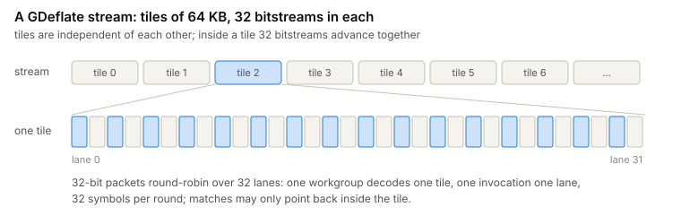
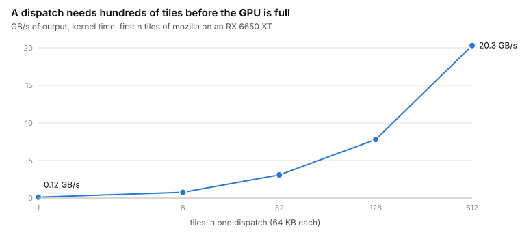
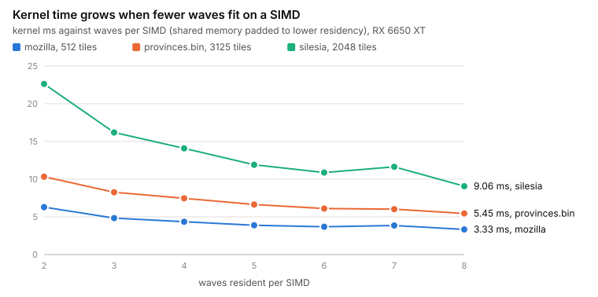
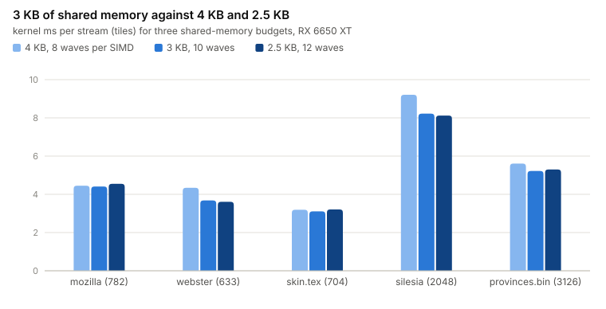
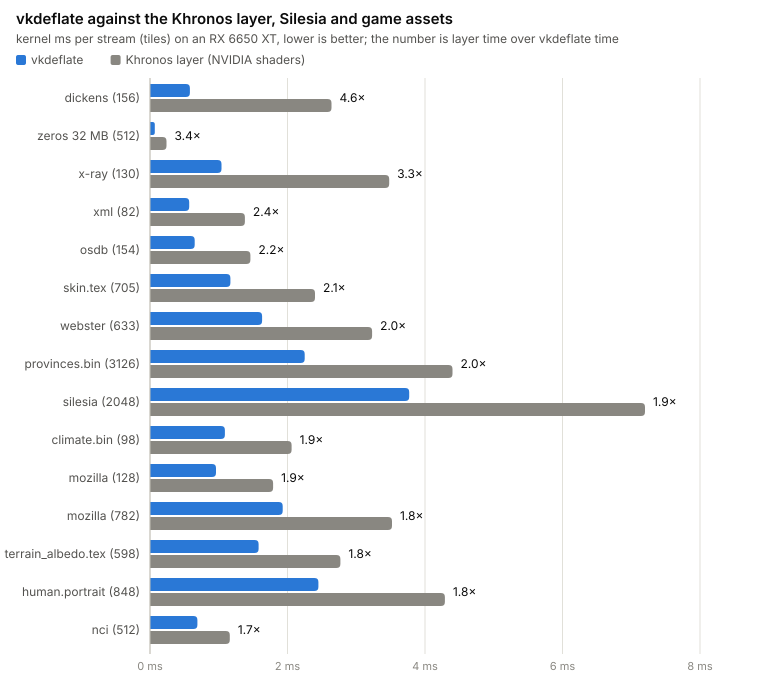
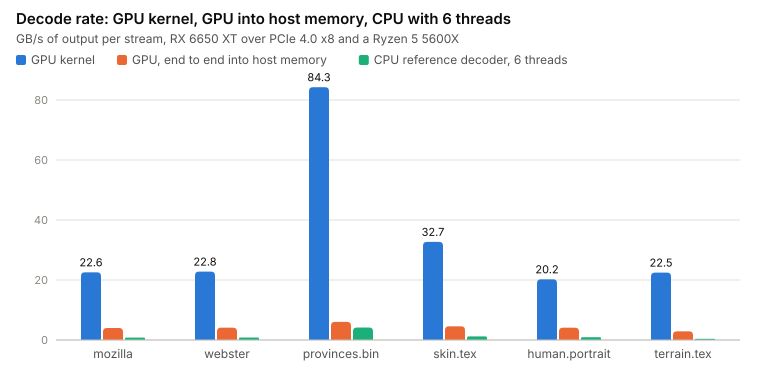
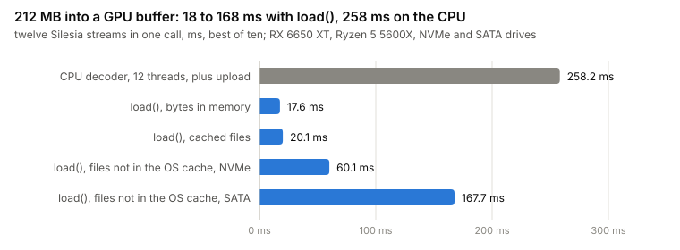

# Writing a GDeflate decoder as a Vulkan compute shader

*November 2026, krisoft20*

I am making a grand strategy game. Its map is a 200 MB file that compresses to 3 MB, and its textures are the usual
tens of megabytes each. I wanted to know whether my GPU, an AMD Radeon RX 6650 XT, could unpack them itself, in
Vulkan. This is what I found, with the numbers first and my opinions at the end.

## Why GDeflate

My first attempt was zstd on the GPU. It died on the format: zstd's matches form one long dependency chain, and the
best I got was the Huffman stage at 6 to 12 GB/s with everything else stuck on the CPU.

GDeflate is DEFLATE rearranged for exactly this problem.

<picture>
  <source media="(prefers-color-scheme: dark)" srcset="img/format-dark.svg">
  
</picture>

Tiles never reference each other, so thousands decode at once. Inside a tile, 32 bitstreams advance together, so
one tile fills one 32-wide SIMD unit. It is the format behind DirectStorage and RTX IO, which means the encoder
already exists and is open.

What did not exist for my card was a decoder. Vulkan's `VK_EXT_memory_decompression` is implemented by NVIDIA's
driver; AMD's does not have it, and I found no other driver that does. So I wrote one: a compute shader, a host
library around it, and a slow, readable CPU decoder to check it against. No code from the reference
implementations; the format document in this repository is what I wrote down while reading them.

## The kernel in four sentences

One workgroup decodes one tile, one invocation owns one bitstream. Every round each lane decodes one symbol, a
prefix sum over the lanes turns sizes into output positions, and literals are stored at once. Matches are copied a
round later, when their distances are known. The first version that produced correct bytes took 14 ms for the 51 MB
`mozilla` file, the first release 4.5 ms, the one in this repository 2.3 ms. The details are in [`DESIGN.md`](DESIGN.md).

## One tile takes half a millisecond or more

I expected memory bandwidth to be the limit. It is nowhere near: the same kernel writes runs of zeros at
140 to 200 GB/s on this card. Real data goes at 15 to 25 GB/s because a round is a chain of dependent table lookups,
and a GPU core runs dependent chains slowly. I measured 0.2 to 0.3 instructions per cycle.

A tile is 750 to 2000 such rounds in a row, half a microsecond to a microsecond each, and nothing in the format
shortens that chain. So one tile takes 0.6 to 1.2 ms however idle the GPU is, and so do thirty-two.

<picture>
  <source media="(prefers-color-scheme: dark)" srcset="img/saturation-dark.svg">
  
</picture>

For a game this means putting many small assets into one dispatch.

## What made it faster

- A match with distance 1 to 4 is a repeating pattern, so it is written as constant dwords without reading
  anything. The map went from 9.3 to 7.3 ms.
- Matches that read what the previous round just wrote used to go through global memory behind a barrier. A
  512-byte mirror of the newest output in shared memory removes that round trip: 10 to 14 % faster on binaries,
  5 to 8 % slower on plain text, which has few such matches.
- Less shared memory per tile means more tiles in flight on a SIMD unit, and every slot counts once the GPU is
  full.

<picture>
  <source media="(prefers-color-scheme: dark)" srcset="img/residency-dark.svg">
  
</picture>

Halving the literal table (a 9-bit root instead of 10) took the kernel from 4 KB to 3 KB, 8 to 10 waves per SIMD.
It doubles the rounds that fall back to the slow decode path, and it is still 7 to 15 % faster on big batches.

<picture>
  <source media="(prefers-color-scheme: dark)" srcset="img/lds-dark.svg">
  
</picture>

## What did not help

- Dword copies for long matches, the textbook fix with a quarter of the memory instructions, showed nothing
  outside the noise in three A/B runs. The cost of copies was somewhere else, as the second pass found.
- Dropping the ring to get down to 2 KB gave sixteen waves per SIMD and was 10 to 30 % slower on binaries. The
  ring was worth more than the slots.
- Short copies pipelined across rounds still waited for their loads, and the kernel grew by 17 registers.

Every comparison is interleaved, best of several rounds, on a machine that swings by 10 % with whatever else is
using the GPU.

## Three bugs the tests caught

- The ring was correct on paper and wrong on four tiles. Output is not written in position order: a match lands a
  round after the literals behind it, so a late copy overwrote a newer byte's slot.
- I shrank an array from 44 to 43 words and left a loop bound at 44. The extra word was the start of the ring in
  the new layout, and two tiles out of twelve thousand came out wrong.
- With a distance of exactly 128 and an unaligned start, one lane read two bytes of a match before another lane
  had written them. Two zeros then travelled down the copy every 128 bytes.

All three were deterministic, and I found none of them by reading the shader. What found them: 811 MB of
streams from the reference encoder compared byte for byte, a fuzzer that checks the CPU and GPU agree on every
broken input, and a CPU decoder simple enough to trust.

## Against the other open decoder

Late in the project I learned that an open GPU decoder already existed: NVIDIA's own GLSL shaders, inside a Khronos
layer that emulates the older `VK_NV_memory_decompression`. vkd3d-proton carries a copy for DirectStorage games on
Linux. It uses the same mapping, 32 invocations per tile, so the comparison is fair: both decoders in one command
buffer, same buffers, GPU timestamps around each, order alternating, both outputs checked.

<picture>
  <source media="(prefers-color-scheme: dark)" srcset="img/khronos_all-dark.svg">
  
</picture>

The first release was within a few percent of the layer on large text, 1.3x faster on the map and on textures,
and 6 % slower on one database dump. After the second pass below it is 1.5x to 1.9x faster on large text and
textures, 2x to 4x on streams full of short matches, and 2x on the database dump. I tuned my kernel on this
card; the other one was written by NVIDIA.

## The second pass

The slowest streams after the first release were a sound file, a font, the map and `mozilla`. The profiler I had,
a shader clock read around each phase of a round, made the kernel four times slower and blamed the wrong phases.
What worked was ablation: build a variant without one part, accept the wrong output, and time it. Taking out the
own-lane copies of short matches halved the time of the database dump, the font and `dickens`. Keeping their
loads and dropping only the stores still left 40 %. Making every lane write to the same 128-byte line changed
nothing. The time went into 24 byte stores per lane, each behind its own test of whether that byte belongs to the
match.

- Each lane now writes the whole rounded block of its match without a test, in descending offsets, so a later
  match repairs what an earlier one spilled into it. The literals of the round and of the one before are then
  stored again. 12 to 24 % on copy-heavy streams.
- The map's two heaviest tiles were the last two in the stream, and the end of the dispatch was spent on them
  alone. Sorting the tile table by compressed size, largest first: 10 % on textures, 7 % on `mozilla`.
- The map is almost all long runs, and it got faster with 4 waves per SIMD instead of 10: 3.0 to 2.4 ms. Every
  other stream got slower, so only streams compressed under 1/20 get that pipeline.

With those and a few smaller changes, on my card: the sound file 0.92 to 0.71 ms, the font 1.01 to 0.77 ms, the
database dump 0.93 to 0.72 ms, the map 3.38 to 2.37 ms, `mozilla` 2.56 to 2.26 ms.

A prefetch kept in registers never worked: the compiled loop copies the register at its end, with a wait for the
load right there. A switch that only selects dead code moved the other variant's time by 10 to 15 %, so every
comparison in this pass is two separate builds.

On a friend's RX 9070 XT the same build is 1.19x to 2.8x faster than the layer. Small copy-heavy dispatches gained
as much as on my card. Large textures gained nothing: the kernel now needs 191 vector registers on that compiler,
fewer waves fit, and the layer is relatively faster there. Some large streams are 3 to 4 % slower there than with
the previous version. I have no RDNA 4 card, so I cannot narrow this down or fix it.

Later passes brought the registers there back to 94, and the time did not change. From the last test package: one
wave takes 23 to 30 % longer per tile on the RX 9070 XT than on my card, and that card does not fill up before
about 512 tiles (mine at about 128). Ten of the twelve Silesia streams have 512 tiles or fewer, so a dispatch
there takes as long as its slowest tile. Taking the votes of a round together, where the profile had its gaps,
made it 3 to 8 % slower there.

## What I think

**GDeflate compresses like zlib.** zstd and Oodle pack tighter. That difference in file size is what you pay for a
format a GPU can decode.

**GPU decompression does not shorten loading by much.**

<picture>
  <source media="(prefers-color-scheme: dark)" srcset="img/cpu_gpu-dark.svg">
  
</picture>

The kernel decodes at 23 to 91 GB/s. If the result has to come back to host memory, the copy over PCIe brings that
down to 3 to 6 GB/s, which is what a few CPU threads of a good zstd decoder do. GPU decompression makes sense
when the data stays on the GPU and the GPU is otherwise idle, which means loading screens, or when CPU cores are
the scarce thing. During gameplay it
competes with rendering, and the DirectStorage titles that shipped with it show mixed results
([Ratchet & Clank](https://www.tomshardware.com/news/directstorage-bug-destroys-frame-rates-in-ratchet-and-clank-rift-apart),
[Spider-Man 2](https://pcgamer.com/hardware/graphics-cards/spider-man-2s-pc-launch-woes-are-woe-ier-than-you-think-as-it-looks-like-gpu-powered-directstorage-is-hobbling-performance)).

<picture>
  <source media="(prefers-color-scheme: dark)" srcset="img/load-dark.svg">
  
</picture>

With `load()` the files end up decoded in a GPU buffer or image. The twelve Silesia streams in one call, 212 MB:
17.6 ms from bytes in memory, 20.1 ms from cached files, 60.1 ms from files not in the OS cache on an NVMe drive
and 167.7 ms on a SATA drive. The CPU decoder on 12 threads plus the upload of its output: 258 ms. With files not
in the cache most of the time is the read itself: the 71 MB alone take 49 ms on the NVMe drive and 149 ms on the
SATA drive.

**For my own game it saves tens of milliseconds per large asset.**

## If you want to help

A result from an NVIDIA or Intel card, or a failure, is what this needs most: it has run on two AMD GPUs only.
`bench.cmd` downloads the Silesia corpus, compresses it, decodes it on your card and writes a CSV; `bench.cmd -khr`
adds the Khronos layer for comparison.
